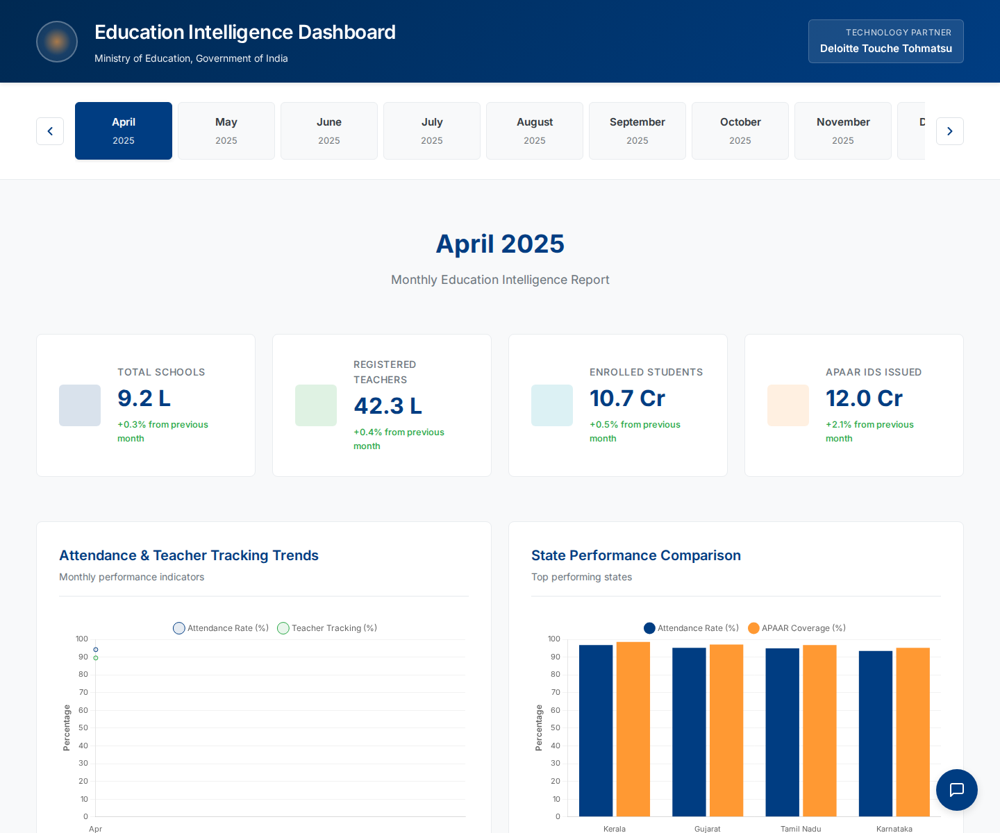
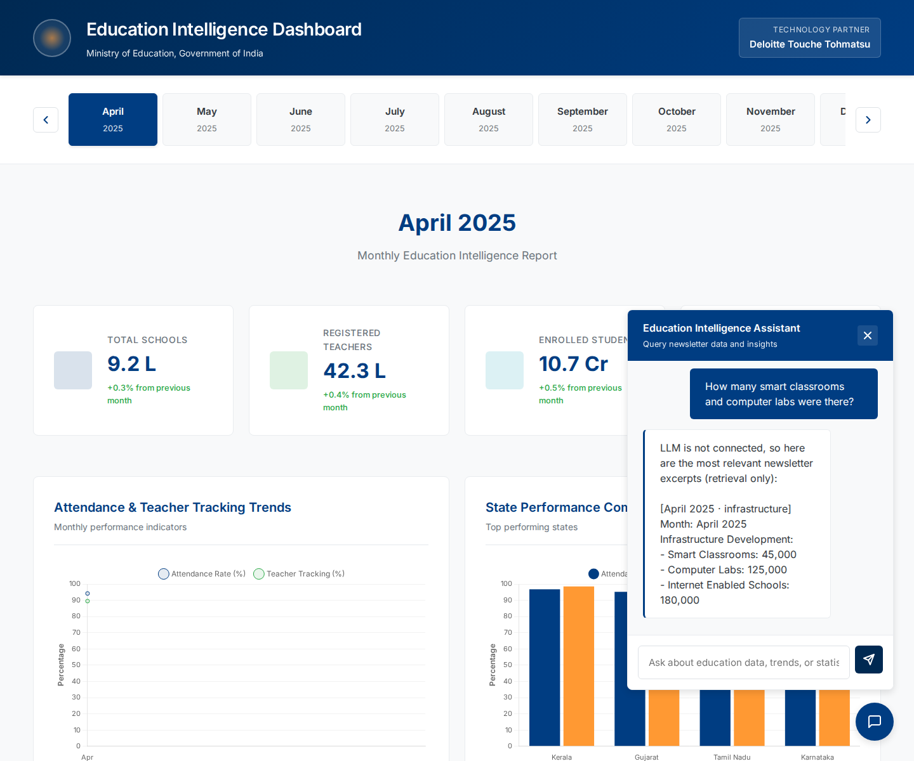
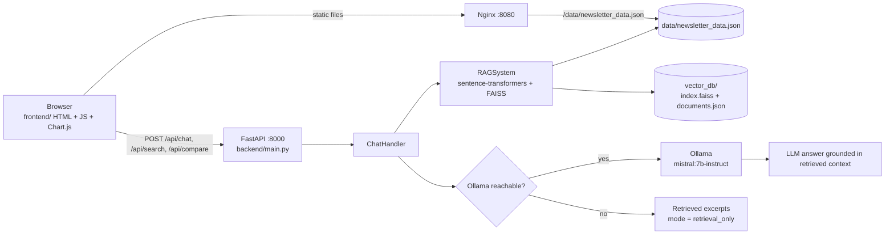

# Education Intelligence Dashboard (MoE newsletter command center)

> Turns monthly Ministry of Education newsletter data into an interactive dashboard with FAISS semantic search and a local-LLM (Ollama) chatbot that falls back to plain retrieval when no LLM is running.

[](https://github.com/Akshatb848/Deloitte-South-Asia-projects/actions/workflows/ci.yml)
[](#license)
[](https://www.python.org/)
[](https://fastapi.tiangolo.com/)





<sub>Screenshots captured headlessly with Playwright (<code>scripts/capture_screenshots.py</code>) on a CI runner with the real <code>all-MiniLM-L6-v2</code> embedding model and <b>no LLM running</b>, so the chatbot shows its retrieval-only fallback. All figures come from the sample dataset in <code>data/newsletter_data.json</code>.</sub>

Built with Deloitte (South Asia) as an Education Intelligence Dashboard for India's Ministry of Education.

---

## Key features

- **Month timeline** – switch between April 2025 and January 2026; KPI cards (schools, teachers, students, APAAR IDs) animate to the selected month.
- **Chart.js analytics** – attendance / teacher-tracking trends, state comparison, infrastructure and APAAR charts.
- **Semantic search** – newsletter data is chunked (overview, highlights, events, state performance, infrastructure), embedded with `sentence-transformers/all-MiniLM-L6-v2` and indexed in FAISS; the index is persisted to `vector_db/`.
- **Ollama chatbot** – retrieved chunks are passed to a local model (default `mistral:7b-instruct`) with a prompt that tells it to answer only from the context.
- **Retrieval-only fallback** – if Ollama is unreachable, `/api/chat` returns the top retrieved excerpts verbatim (`"mode": "retrieval_only"`) instead of failing.
- **Structured comparisons** – state-vs-state comparisons are computed directly from the JSON, not generated.
- **Query-to-visualization hints** – chat responses can point the UI at the relevant chart.
- **Rate limiting** on chat / compare / search endpoints (slowapi).

## Architecture



## Tech stack

| Layer | Tools |
|---|---|
| Frontend | HTML5, CSS3, vanilla JavaScript, Chart.js |
| Backend | Python 3.10+, FastAPI, Uvicorn, Pydantic, slowapi, httpx |
| Retrieval | sentence-transformers (`all-MiniLM-L6-v2`), FAISS (`IndexFlatL2`), NumPy |
| LLM | Ollama (Mistral 7B Instruct by default; any Ollama model via `LLM_MODEL`) |
| Ops | Docker, Docker Compose, Nginx, GitHub Actions |

## Quick start

### Docker (backend + Ollama + Nginx)

```bash
git clone https://github.com/Akshatb848/Deloitte-South-Asia-projects.git
cd Deloitte-South-Asia-projects
cp .env.example .env
docker compose up -d --build
# optional – enable the LLM:
docker exec -it education-dashboard-ollama ollama pull mistral:7b-instruct
```

- Dashboard: <http://localhost:8080>
- API docs: <http://localhost:8000/docs>

Without pulling a model the chatbot still works in retrieval-only mode.

### Local (no Docker)

```bash
python -m venv .venv && source .venv/bin/activate
pip install torch --index-url https://download.pytorch.org/whl/cpu   # optional: CPU-only PyTorch
pip install -r requirements-dev.txt
cp .env.example .env

uvicorn backend.main:app --port 8000          # first run downloads the embedding model
python -m http.server 8080                    # in another terminal, from the repo root
```

Open <http://localhost:8080/frontend/index.html>. To enable the LLM, install [Ollama](https://ollama.com), then `ollama pull mistral:7b-instruct` and `ollama serve`.

## Environment variables

See [`.env.example`](.env.example).

| Variable | Default | Purpose |
|---|---|---|
| `OLLAMA_HOST` | `http://localhost:11434` | Ollama server; if unreachable the chatbot uses retrieval-only mode |
| `LLM_MODEL` | `mistral:7b-instruct` | Ollama model name |
| `EMBEDDING_MODEL` | `sentence-transformers/all-MiniLM-L6-v2` | Embedding model for the FAISS index |
| `VECTOR_DB_PATH` | `./vector_db` | Where the FAISS index and chunk store are saved |
| `CORS_ORIGINS` | `["http://localhost:3000"]` | JSON list of allowed browser origins |
| `API_HOST` / `API_PORT` | `0.0.0.0` / `8000` | Used when running `python backend/main.py` |

## API

| Method | Path | Description |
|---|---|---|
| GET | `/api/health` | `healthy` / `degraded`, LLM and RAG status |
| POST | `/api/chat` | `{"query", "current_month"?, "include_visualization"?}` → `{response, sources, visualization, mode}` |
| POST | `/api/search?query=…&top_k=5` | Raw semantic search results |
| POST | `/api/compare` | `{"entities": ["Kerala","Gujarat"], "metric": "attendance", "months": ["April_2025"]}` |
| GET | `/api/newsletter/months` | Available month keys |
| GET | `/api/newsletter/{month}` | One month's data, e.g. `June_2025` |

More detail: [docs/API.md](docs/API.md), [docs/DEPLOYMENT.md](docs/DEPLOYMENT.md).

## Testing

```bash
pytest -q          # API + retrieval tests; offline (deterministic stand-in embedder), Ollama not required
RUN_MODEL_TESTS=1 pytest -q -m real_model   # also downloads and tests the real embedding model
ruff check .
python test_installation.py                 # checks the local dependency install
```

CI (GitHub Actions) runs ruff and pytest on Python 3.10, 3.11 and 3.12, the real-model retrieval test on 3.11, and builds the backend Docker image and checks `/api/health` in the container.

## Project structure

```
backend/
  main.py                 FastAPI app, endpoints, rate limiting, CORS
  api/chat_handler.py     intent routing, comparisons, LLM / retrieval-only answers
  rag/rag_system.py       chunking, embeddings, FAISS index build/load/search
  llm/llm_handler.py      Ollama client, system prompt, intent analysis
data/newsletter_data.json sample monthly newsletter data (Apr 2025 – Jan 2026)
frontend/                 index.html, css/style.css, js/app.js
config/nginx.conf         static hosting + /api reverse proxy
tests/                    pytest suite
scripts/                  Playwright screenshot capture
docs/                     API, deployment and Python-compatibility notes
```

## Limitations

- The dataset is a small bundled JSON sample (10 months, 4 states), not a live feed; there is no PDF/newsletter ingestion pipeline. Figures are for demonstration and are not an official statistical release.
- FAISS search always returns the nearest chunks; there is no relevance threshold, so off-topic questions still get the closest excerpts.
- With an LLM enabled, grounding relies on the prompt; generated answers are not automatically verified against the sources.
- The LLM is also used for intent classification; without it every query is treated as a factual lookup (the `/api/compare` endpoint still works).
- No authentication. The frontend calls the API at `http://localhost:8000/api` (set in `frontend/js/app.js`).
- The first start downloads the embedding model, and PyTorch (pulled in by sentence-transformers) is a large dependency.

## License

No open-source license is granted. The original project README states:

> Copyright © 2026 Ministry of Education, Government of India. All rights reserved.
> This software is proprietary and confidential. Unauthorized copying, distribution, or use is strictly prohibited.

## Author

**Akshat Banga** — AI Generalist · [github.com/Akshatb848](https://github.com/Akshatb848)
